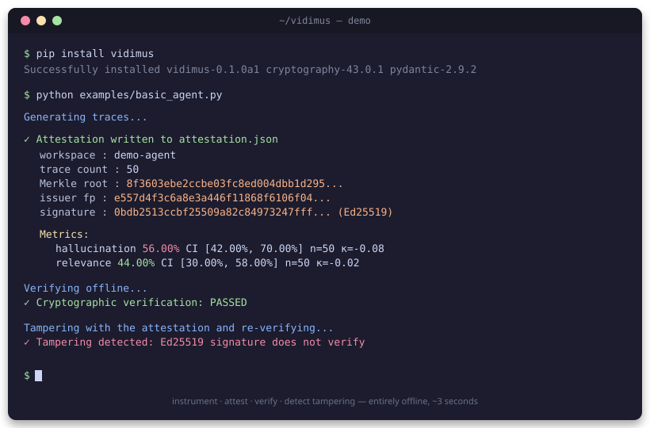

<div align="center">

# Vidimus

### The trust layer for agentic AI

*Verifiable, auditable, cryptographically attested LLM and agent behavior for safety-critical, industrial, and research deployments where AI decisions must be reviewable after the fact.*

[](https://github.com/kabNath/vidimus/releases)
[](https://www.python.org/downloads/)
[](LICENSE)
[](https://github.com/kabNath/vidimus/actions)
[](#run-with-docker)

[Quickstart](docs/quickstart.md) • [Architecture](ARCHITECTURE.md) • [Roadmap](ROADMAP.md)

</div>

<p align="center">
  
</p>

---

> **vidimus** *(Latin, "we have seen")* — the medieval legal formula used by a scribe or notary to certify that an original document had been personally examined before producing an attested copy. The seal on the bottom said: this is true, and here is the proof.

## Why Vidimus exists

Modern LLM observability tools tell you *what* your agent did. Some tools can already prove the *integrity* of records (hash chains, signed logs, transparency logs); what is rarely shipped with an evaluation report is a **metric with an explicit confidence interval and a measure of agreement between judges**, together with a signature a third party can check offline. That combination is what Vidimus adds.

When a compliance officer asks "can you guarantee this evaluation report wasn't tampered with after the fact?", the answer is no. When a regulator asks "what's the confidence interval on that hallucination score?", the answer is silence. When a customer asks "can I verify this audit independently, without trusting your vendor?", the answer is "trust us."

Vidimus closes those gaps with three primitives the existing stack lacks:

1. **Tamper-evident traces** every agent interaction hashed and chained in a Merkle tree, so any post-hoc modification is detectable.
2. **Calibrated uncertainty** every evaluation metric ships with a bootstrap confidence interval and multi-judge agreement score, not a point estimate dressed up as truth.
3. **Cryptographic attestations** Ed25519-signed evaluation reports, optionally anchored on-chain (BNB Chain, Ethereum, or any EVM), verifiable offline by any third party.

Drop it in next to your existing observability tool in three lines, or run it standalone.

## Quick start

```bash
pip install vidimus
```

```python
import vidimus

vidimus.init(workspace="acme-prod")

@vidimus.audit
def my_agent(query: str) -> str:
    # your existing agent code
    return llm.invoke(query)
```

Generate a signed attestation over the last 24 hours of traces:

```bash
vidimus attest --since 24h --output report.json
```

Export the traces the report covers, then verify offline, without contacting your server. Pin the issuer key (`--trusted-key`, or `--trusted-keys-file`) so the check proves *who* signed, not just that the file is intact:

```bash
vidimus export --against report.json -o traces.jsonl
vidimus verify report.json --traces traces.jsonl --trusted-key c1410284d7b9c5b29ee0a22bd5553195d21de60070b9dd81ce02391beac137af
```

```text
✓ attestation report.json is valid
⚠  warnings:
    - metric 'hallucination': low inter-judge agreement (κ=0.03); interpret with extra caution
  workspace    : acme-prod
  period       : 2026-10-05 09:04:38.064727+00:00 → 2026-10-06 09:04:38.064727+00:00
  trace count  : 40
  Merkle root  : d02f29b042ea4f078c2d8cc7fdb157cd11e8428f2039729f09e889fedfe91f61
  signed by    : c1410284d7b9c5b29ee0a22bd5553195d21de60070b9dd81ce02391beac137af
  issuer pinned: yes
  traces check : Merkle root matches 40 traces
  on-chain     : none in report
  hallucination            55.00% [CI 40.00% – 70.00%] n=40  κ=0.03
```

This is the real output of a run on 40 traces scored by three stub judges (values, timestamps and keys differ on every run; the low κ is expected from stub judges). `verify` only reports what it checked:

| Line | When it is checked |
|---|---|
| signature, key/fingerprint, metric intervals | always |
| `issuer pinned: yes` | with `--trusted-key` / `--trusted-keys-file`; otherwise a warning says the signature proves integrity, not identity |
| `traces check : Merkle root matches N traces` | with `--traces <export>`; otherwise `not checked (pass --traces)` |
| `on-chain` | with `--check-anchor --rpc-url <url>` (needs `pip install vidimus[onchain]`) when the report has an anchor; otherwise `not checked (pass --check-anchor)`, or `none in report` |

That's it. You now have a portable, cryptographically verifiable artifact of your agent's behavior.

### Run with Docker

If you prefer a containerized setup:

```bash
docker build -t vidimus:latest .
docker run --rm vidimus:latest version

# Or with docker compose, with persistent keystore and attestation output:
docker compose run --rm vidimus keys generate
docker compose run --rm vidimus attest --since 24h --output /output/report.json
```

The image is a multi-stage build (~150 MB final), runs as a non-root user, and ships no build tooling in production. See [`Dockerfile`](Dockerfile) and [`docker-compose.yml`](docker-compose.yml).

### Examples

| File | What it demonstrates |
|---|---|
| [`examples/basic_agent.py`](examples/basic_agent.py) | Minimal end-to-end: instrument an agent, attest, verify, detect tampering |
| [`examples/rag_with_vidimus.py`](examples/rag_with_vidimus.py) | Didactic RAG (TF-IDF retriever + stub generator) showing the instrumentation pattern |
| [`examples/rag_production.py`](examples/rag_production.py) | **Production RAG** with sentence-transformers embeddings, FAISS index, and Ollama generator |
| [`examples/opik_integration.py`](examples/opik_integration.py) | Dual decoration (`@opik.track` + `@vidimus.audit`) — Vidimus on top of Comet Opik |
| [`examples/langchain_integration.py`](examples/langchain_integration.py) | LangChain Q&A chain instrumented with Vidimus via OpenTelemetry |


## Known limitations

Read these before relying on an attestation.

- **A signature proves integrity, not identity.** The issuer's public key is embedded in the report, so anyone can produce a self-consistent, validly signed report with their own key. **Pin the issuer key**: `vidimus verify report.json --trusted-key <fingerprint>` (or `--trusted-keys-file`). Without it, `verify` warns: *issuer key not pinned: signature proves integrity, not identity*.
- **Garbage in, garbage out.** Vidimus proves that the traces and scores were not altered after signing. It does not prove that the traces are complete, that the agent was instrumented everywhere, or that the judges' scores are *right*.
- **Judge bias is not captured by the interval.** The bootstrap interval measures sampling noise over the scored traces. If all LLM judges share the same blind spot or bias (same model family, same prompt), they will agree with each other and be wrong together; high inter-judge agreement (κ) is not evidence of correctness. The stub judges used in examples are heuristics, not evaluators.
- **The Merkle root is only checked if you ask.** `vidimus verify` recomputes it only with `--traces <export>`, and checks the on-chain anchor only with `--check-anchor`; otherwise it prints `not checked`. An on-chain anchor adds a public timestamp, not extra cryptographic strength.
- **Persistence needs DuckDB.** By default traces go to a DuckDB file per workspace (`~/.vidimus/workspaces/<workspace>/traces.duckdb`, or under `$VIDIMUS_HOME`), so `vidimus attest`, `prove`, `export` work from another terminal after your application exits. `duckdb` is an optional dependency (`pip install vidimus[duckdb]`); without it the store falls back to memory with a warning and the CLI sees nothing. A DuckDB file can be opened by one process at a time: while your application is running, the CLI reports that the store is locked. `init(store="memory")` keeps the old ephemeral behaviour (tests).
- **Alpha software.** APIs and the Merkle layout can change between releases.

## Architecture

```
                          your application
                                 │
                                 ▼
              ┌──────────────────────────────────┐
              │ @vidimus.audit  or  OTel exporter │
              └─────────────────┬────────────────┘
                                │ (spans, traces)
                                ▼
              ┌──────────────────────────────────┐
              │ vidimus.audit (this module)      │
              │                                  │
              │  • Merkle-chained trace store    │
              │    (DuckDB or ClickHouse)        │
              │  • Multi-judge eval pipeline     │
              │  • Bootstrap CI calibration      │
              │  • Ed25519 signer                │
              │  • Optional EVM anchor           │
              └─────────────────┬────────────────┘
                                │
                                ▼
              ┌──────────────────────────────────┐
              │   signed attestation.json        │
              │   verifiable offline, anywhere   │
              └──────────────────────────────────┘
```

Full technical design in [ARCHITECTURE.md](ARCHITECTURE.md).

## Roadmap

Vidimus will ship in three sequenced modules under one project — a trust stack for the entire agent lifecycle.

| Module | Status | What it provides |
|---|---|---|
| **`vidimus.audit`** (Module A) | 🚧 alpha, this repo | Tamper-evident traces, calibrated uncertainty, cryptographic attestations |
| **`vidimus.optimize`** (Module B) | 🗓 2026 | DRL-based prompt and agent optimization (PPO, MADDPG), with the same audit guarantees applied to the optimization process itself |
| **`vidimus.federate`** (Module C) | 🗓 2027 | Federated evaluation with secure aggregation and differential privacy, for data that cannot leave its environment |

The thesis tying them together: **trustworthy agents that improve over time without compromising privacy.** Each module is independently useful and independently installable.

See [ROADMAP.md](ROADMAP.md) for the detailed plan.

## Use cases

**Regulated industries.** Financial services, healthcare, legal, public sector — anywhere an auditor will eventually ask "prove it." Vidimus produces the artifact.

**High-stakes agent decisions.** When an agent makes a recommendation that affects money, health, or rights, the decision trail should be cryptographically verifiable, not a screenshot.

**Open evaluations and benchmarks.** Researchers and labs can publish signed attestations of their evaluation runs that anyone can verify, removing the "did they cherry-pick?" doubt from leaderboards and papers.

**Investor and customer reporting.** Performance claims backed by signed evaluation artifacts instead of unfalsifiable dashboards.

## Status

Vidimus is in **alpha**. The Python SDK surface may change before v1.0.0. The cryptographic primitives (Ed25519 signatures, RFC 6962 Merkle trees, RFC 8785 canonical JSON) are expected to stay stable, but 0.1.0a3 changed the Merkle layout (see [CHANGELOG](CHANGELOG.md)); do not assume compatibility between alpha releases. Production use is at your own risk until v1.0.

We are actively looking for:

- Cryptography review of the attestation format
- Calibration methodology improvements (alternatives to bootstrap CI, better multi-judge aggregation)
- Additional OpenTelemetry exporter integrations
- Translators for docs (French and Mandarin in particular)

## Contributing

See [CONTRIBUTING.md](CONTRIBUTING.md). For substantial contributions, please open a discussion first.

## License

Apache 2.0. See [LICENSE](LICENSE).

## Citation

If you use Vidimus in research, please cite:

```bibtex
@software{vidimus2026,
  author  = {Kaboré, Wendenda Nathanael},
  title   = {Vidimus: A Trust Layer for Agentic AI},
  year    = {2026},
  url     = {https://github.com/kabNath/vidimus},
  license = {Apache-2.0}
}
```

## Used by

- **[spec-conformance-agentic](https://github.com/kabNath/spec-conformance-agentic)** — 3GPP/O-RAN conformance agent using vidimus primitives (bootstrap CI, RFC 8785 canonicalization, Ed25519 signing) for signed verdicts; integration verified in CI.

## Acknowledgments

Vidimus stands on the shoulders of OpenTelemetry, Pydantic, FastAPI, DuckDB, and the broader LLM observability community Opik, Langfuse, LangSmith, OpenLLMetry, Phoenix. The statistical methodology draws on Fleiss (1971), Krippendorff (1970), Efron (1979), and the long line of work on inter-rater reliability that the LLM-as-judge literature has, until now, largely ignored.
